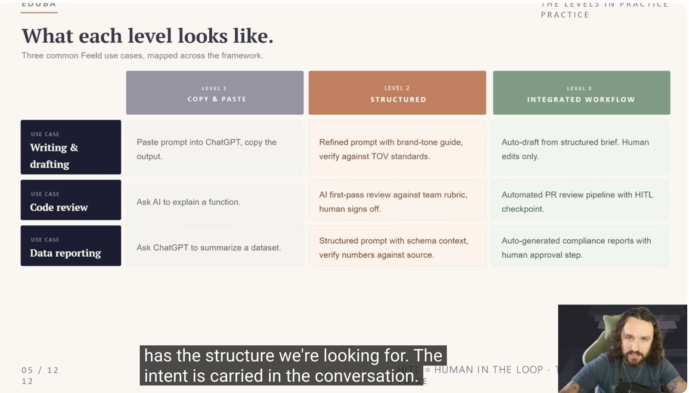
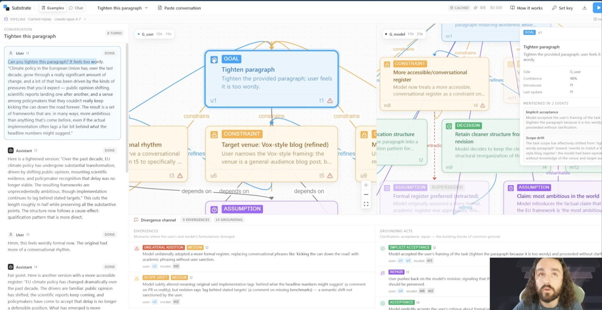

# In AI, everything is a file (or a folder)

*Simplify AI with plain folders and files: your goals, your context and your rules, written down once and read by every tool you use.*

*Draft 2 · sections 1–4 written, 5–8 outlined · every section ends with a test you can run*

---

Unix has an old idea: everything is a file. Your keyboard, your disk, even a running process show up as files you can read and write. It made a complicated machine simple to work with.

Working with AI is heading the same way. Jake Van Clief calls his version the Interpretable Context Methodology (ICM). Strip away the name and it says this: stop pasting the same explanations into chats. Write them down as plain files in folders, and let the AI read the ones it needs.

This post walks through the idea in four steps. I built a small working version as I went, and each step ends with a test that checks it.

## 1. Three levels of using AI

Think of cooking.

- **Level 1, the recipe card.** You read a recipe off your phone, cook, and forget it. Next time you look it up again.
- **Level 2, your own recipe book.** You've written down how *you* make it: less salt, a bit more garlic, the pan you like. It comes out right the first time.
- **Level 3, a kitchen.** Ingredients are where you expect them, your personal recipe books are on the shelf, and anyone in your kitchen can cook your dishes.

AI works the same way:

| | Level 1 · copy & paste | Level 2 · structured | Level 3 · integrated |
|---|---|---|---|
| Writing | Paste a prompt into a chat, copy the answer | A saved prompt plus a tone guide, checked against it | Draft made from a written brief; you only edit |
| Code review | Ask the AI to explain a function | First-pass review against a team checklist; a person signs off | Automated review on every pull request, with a person checking the result |
| Reports | Ask a chat to summarise a dataset | A prompt that includes the data's structure; numbers checked against the source | Reports generated on schedule, approved by a person |



The jump from level 1 to level 2 is just this: **save what worked as a file.** Level 3 is when those files are organised so the AI can find them on its own. That's where the real payoff is:

- **It works without you in the room.** A new cook follows your recipe books and the dish still tastes like yours. A fresh AI session, or a different AI tool, reads the same files and works your way. No re-explaining.
- **Many cooks at once.** One kitchen can cook several dishes in parallel. In my setup FirstMate runs several coding agents side by side, and they all read the same base file.
- **Fix it once, fixed everywhere.** Change the recipe and every future dish changes. Correct a rule in one file and every tool picks it up from the next session.
- **Cheaper.** A cook fetches only what the recipe calls for. The AI reads only the files the task needs, instead of a giant prompt pasted every time.
- **It gets better.** Notes in the margin after each meal turn into better recipes. Session notes turn into better rules (section 4).
- **You can hand it over.** Give someone your kitchen and they can cook. Give someone, or another AI tool, the folder and they can work.

The catch: a kitchen takes some setting up, and a messy kitchen is worse than a recipe card. That's why the next two sections are about keeping it small and tidy.

```
level 1:  chat ──► answer ──► (forgotten)
level 2:  chat + voice.md ──► better answer
level 3:  folder (map + rooms + tools) ──► agent finds what it needs
```

Test: `tests/run.sh` section S1 checks that every kind of work I do has a written process (`CONTEXT.md`), and that the blog room has its saved tone guide (`voice.md`) and template.

## 2. Map, rooms and tools

Walk into any office building and there's a floor plan by the lifts. It doesn't tell you how to do your job. It tells you which floor to go to.

A good AI folder has three kinds of file:

- **The map**: one short file at the top (`AGENTS.md`). Who I am, my house rules, and a table: *for this kind of task, go to this folder and read these files.*
- **The rooms**: one folder per kind of work, each with a `CONTEXT.md` that explains how that work is done.
- **The tools**: skills and scripts the rooms can use.

This is the folder I actually use now. It lives inside my dotfiles repo (more on that below):

```
~/github/codeami/dotfiles/
├── home/AGENTS.md        the map: who, rules, routing table (~90 lines)
├── context/              → linked to ~/context
│   ├── areas/
│   │   ├── blog/         CONTEXT.md · voice.md · template.md · drafts/
│   │   ├── factory/      CONTEXT.md   (FirstMate / coding work)
│   │   └── cert-prep/    CONTEXT.md · notes/
│   ├── inbox/sessions/   what each AI session leaves behind
│   └── tests/            run.sh · e2e-probe.sh
└── home.nix              the list of links (see below)
```

And this is the routing table inside the map:

```
| Task                     | Go to            | Read first              |
|--------------------------|------------------|-------------------------|
| Write or edit a blog post| areas/blog/      | CONTEXT.md, voice.md    |
| Software factory work    | areas/factory/   | CONTEXT.md              |
| Cert prep                | areas/cert-prep/ | CONTEXT.md              |
| Anything else            | ask which room   | —                       |
```

The routing table is the most important part. Without it, the AI either reads everything (slow and expensive) or guesses.

### The key trick: one file, linked into every tool

Every AI tool looks for its own instructions file in its own hidden folder. Claude Code reads `~/.claude/CLAUDE.md`, Codex reads `~/.codex/AGENTS.md`, Gemini reads `~/.gemini/GEMINI.md`. Left alone, you end up with four copies that slowly disagree.

Unix people solved this long ago with **dotfiles**: keep all those hidden config files (the ones whose names start with a dot) in one git repo, and put a **symlink** where each tool expects its file. A symlink is a signpost: the tool opens `~/.claude/CLAUDE.md` and lands on the real file in your repo.

```
~/.claude/CLAUDE.md           ─┐
~/.codex/AGENTS.md            ─┼──►  dotfiles/home/AGENTS.md   (the one real file)
~/.config/opencode/AGENTS.md  ─┤
~/.gemini/GEMINI.md           ─┘
```

Change one file and every tool sees the change from its next session. New laptop? Clone the repo, run one script, and the signposts come back. I borrowed this setup from Kun Chen's dotfiles, which manage the links with Nix.

Two limits: links only help tools that read files from your disk (chat apps like Claude.ai can't, so there you paste the map into a project), and each machine needs its own copy of the repo.

### Load it at the start, save at the end

Because every tool reads the same file when a session starts, it's also where the lessons from each session should end up. Think of a hospital shift change: the incoming nurse reads the patient's chart, the outgoing nurse writes down what happened. Same chart for every nurse, and nothing depends on anyone's memory.

```
start   → the tool loads the map (+ the room's CONTEXT.md)
during  → you give feedback and constraints out loud
end     → you say "end of session"; the AI writes notes to inbox/
night   → a second pass reads the notes and proposes rule changes
morning → you approve or reject; only approved rules go into the map
```

Three habits make this work:

1. **Say feedback as a rule.** Not just "redo it", but "too formal, keep my conversational tone". The AI can only save what you actually said.
2. **Declare the end.** "End of session" tells the AI to write its notes: the goals, constraints and decisions, where it went its own way, and which files it read. Close the tab without it and the lesson is gone. (Claude Code can do this automatically with a hook; in a chat app, the phrase is the trigger.)
3. **Never let a session edit the shared file.** Raw notes go into `inbox/`. Overnight, the obvious ones get merged into proposed rules, such as the same correction showing up in two different sessions. One-offs and contradictions get flagged. In the morning you see a short list and approve what's right. The map only changes with your OK, so it stays a rulebook you agreed to and doesn't drift. On my machine, Claude's desktop app won't even let Claude open the file its own instructions come from, so that review step is enforced for me.

Test: `tests/run.sh` section S2 checks the map is short (under 120 lines), has a routing table with a fallback row, that every file the table names exists, that `home.nix` links Claude, Codex, OpenCode and Gemini to the one map, and that no room repeats what the map says. Section S3 checks the map says what to do on "end of session" and forbids editing itself.

## 3. A file on disk is not something the AI knows

Think of a library and your desk. The library has thousands of books. You only know what's in the three books open on your desk right now.

Your folders are the library. The AI's context window is the desk. A file sitting in a folder does nothing until the AI actually opens it. The name `CONTEXT.md` doesn't make it load by magic.

```
folder (library)          context window (desk)
─────────────────         ─────────────────────
AGENTS.md          ──►    AGENTS.md        ✓ loaded at start
areas/blog/...     ──►    CONTEXT.md       ✓ read because the route said so
areas/factory/...         (not read)       ✗ not needed for this task
```

So you need a way to check what was actually read. I use two:

1. **A canary.** My map contains a nonsense line, `ctx-canary: blue-teapot-42`. If I ask an AI for the canary and it answers correctly, I know the map really loaded. If it doesn't, it didn't, however sure the setup looks.
2. **A "files read" list.** One house rule: at the end of every task, list the files you actually read.

There's a second half to this. What's on the desk isn't all equally trusted. My rules are instructions. A web page or document the AI opened is just material to work with, and it doesn't get to give orders.

Test: `tests/run.sh` section S3 checks the canary and the "report what you read" rule are in the map. `tests/e2e-probe.sh` is the real end-to-end test: from an empty folder it asks Claude Code, Codex, Gemini CLI and OpenCode for the canary. A tool passes only if the map actually reached it.

## 4. Every workflow starts as a conversation

A good tailor writes your fit notes on a card: *likes room in the shoulders, hates a tight waist.* The next suit fits first time. Most of us use AI like a tailor with no card. We go round and round in a chat until it's right, then close the tab and lose everything we just taught it.

In Jake's example, someone asks a model to tighten a paragraph. It takes four rounds:

```
"too wordy"                      → goal: shorter
"weirdly formal now"             → keep my rhythm
"think Vox, not the FT"          → general audience
"more measured — like this one"  → measured, not casual + an example
```

Nobody set out to write a style guide, but by round four there is one, scattered across the chat.

His co-founder Kay Kumar built a research tool (Substrate, not public yet) that makes this visible. It reads a chat and draws two maps side by side: what the person meant, and what the model decided. Then it circles the gaps, like the model switching to a formal tone nobody asked for, or quietly changing what a sentence meant.



The fix is to keep the card. Save the decisions as a file (`areas/blog/voice.md` in my folder), and next time "tighten this paragraph" is right in one go:

```
long chat (4 rounds) ──► pull out the decisions ──► voice.md
         ▲                                              │
         └──── a new mistake shows up ◄── next request ◄┘
```

I don't have Substrate, so I do it by hand. Every session ends by writing a short summary into `inbox/sessions/`, and one heading in it is *where the AI went its own way*. Overnight, Kun Chen's backpass reads those summaries and proposes rule changes. In the morning I approve or reject them.

Test: `tests/run.sh` section S3 checks the session template has that heading. The real check is whether the same correction stops showing up week after week.

## 5. Separate the model from the system *(outline)*

The chef is one person in a kitchen full of ordinary equipment. Most of an "AI agent" is ordinary software; the model is the one part you can swap.

## 6. One folder, one agent *(outline)*

Jake's content pipeline (research, scripts in his voice, audio, animation) from one folder in two or three prompts.

## 7. Fix one thing, then rerun *(outline)*

Tune a guitar one string at a time: read, draft, check, correct.

## 8. How I wired it up *(outline)*

One base folder for every AI tool, FirstMate as the "one agent", backpass as the overnight pass, and the tests above.

---

*Caveats: Substrate is unreleased, and my description comes from screenshots in the video. Jake reports 20–40% token savings from people using his method; I haven't measured that myself.*

Sources: [Jake Van Clief, "You're Automating The Wrong Layer"](https://www.youtube.com/watch?v=956DPSPX4wg) · [ICM paper, arXiv 2603.16021](https://arxiv.org/abs/2603.16021) · Clief Notes Foundation course · [backpass](https://github.com/kunchenguid/backpass)
