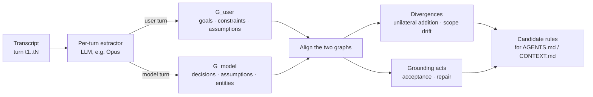
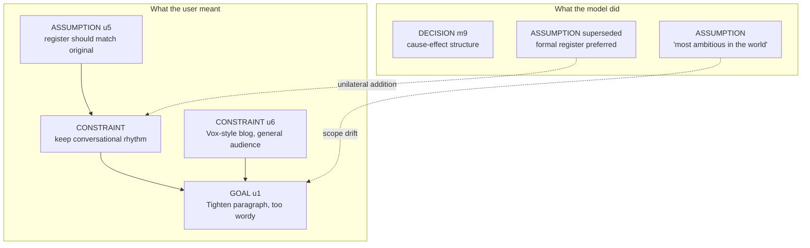

# Substrate: turning a conversation into two decision graphs

Claim: Substrate reads a chat turn by turn and builds two separate graphs — what the **user** meant (`G_user`) and what the **model** decided (`G_model`) — out of the same small set of typed nodes, then lines them up and logs every place they **diverged** and every act that rebuilt **common ground**. The divergences are exactly the rules a future `AGENTS.md` is missing.

## What the screen shows (observed)

| Area | What's there |
|---|---|
| Top bar | Examples / Chat modes · example picker ("Tighten this paragraph") · **Paste conversation** (bring your own transcript) · `CACHED` · `8/8` turns processed · `$0.000` · How it works · **Set key** (bring your own API key) · export |
| Pipeline line | `Cached replay · claude-opus-4-7` — an LLM does the extraction; the demo replays a stored run, hence $0 |
| Left pane | The conversation, 8 turns, each tagged `User t1`, `Assistant t2` … and `DONE` once processed |
| Centre | `G_user` — 12 nodes, 11 edges |
| Right | `G_model` — 17 nodes, 23 edges (the model "decides" more than the user ever said) |
| Node card | type badge · title · one-line gloss · id (`u1`, `m8`) · turn introduced (`t1`, `t5`) · ⚠ if it's involved in a divergence |
| Detail panel (`u1`) | Side `G_user` · **Confidence 98%** · Introduced t1 · Last update t1 · "Mentioned in 2 events": Implicit acceptance, Scope drift |
| Bottom | **Divergence channel**: 9 divergences, 14 grounding acts, each citing the turn and the node ids on both sides (`user: u2 · model: m6`) |

## The data model (inferred)

Node types: **Goal** · **Constraint** · **Assumption** · **Decision** · **Entity** · **Example**.
Node state: active, or **Superseded** / retracted (e.g. model's "Formal register preferred (retracted)").
Edge types: `constrains` · `refines` · `depends on` · `instantiates` · `supersedes` · `contradicts` (red dashed).
Node fields: `id, side, type, title, gloss, confidence, introduced_turn, last_update_turn, status`.

Event types on the divergence channel:
- **Divergences** (with severity): *Unilateral addition* — model adopted something the user never asked for (a formal register replacing "kicking the can down the road"); *Scope drift* — model subtly changed meaning ("lag behind what the headline numbers might suggest" → "lag behind stated targets").
- **Grounding acts**: *Implicit acceptance* — model took the user's framing without checking; *Repair* — user pushes back ("this feels weirdly formal"); *Acceptance* — model explicitly accepts the correction.

"Grounding" is a term from conversation analysis (Clark & Brennan): how two speakers build shared understanding by proposing, accepting and repairing. Substrate applies it to human–model dialogue.

## The pipeline (inferred)

Each turn updates the graph incrementally: new nodes are added, old ones refined or superseded, confidence adjusted; the "last update" field shows a node can change later in the conversation.

## The worked example in one picture

## Blog analogy

Two people leave the same meeting with their own notebooks. Substrate photocopies both, lays them side by side, and circles in red every line one wrote that the other never agreed to — and in green every moment they checked with each other. The red circles are where the next misunderstanding will come from; write them down as rules and the next meeting starts from common ground.

## Why it matters here

- `G_user` is the right shape for the postflight session summary: goals, constraints, decisions, assumptions — not a transcript.
- Divergences are the evidence backpass looks for; "unilateral addition: formal register" becomes the rule "keep the user's register unless asked."
- Confidence + superseded status is what the overnight pass should carry, so the morning review can reject low-confidence or retracted items fast.
- A homegrown version is feasible: one extraction prompt per turn with a fixed node/edge schema, JSON out, a diff step — a good small FirstMate project and a cert-relevant structured-output exercise.
